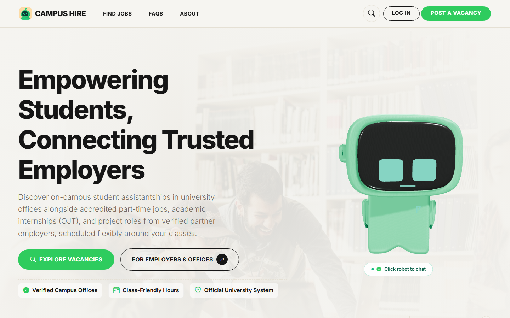

# Campus Hire

**A campus job portal built by BSIS students at Kolehiyo ng Lungsod ng Dasmariñas.**

Campus Hire connects students looking for work experience with campus offices and partner employers. Students can explore opportunities and track applications; employers can manage vacancies and applicants; administrators can review accounts and oversee the portal.



> **Project status:** The project has been defended and active development is complete. This repository is open source and remains available for learning and adaptation. Read the final development journal on the About page.

## What’s inside

- **Students:** browse and filter openings, submit applications, share availability, and follow application progress.
- **Employers:** publish and manage vacancies, review candidates, and post updates.
- **Administrators:** review accounts and verification documents, manage categories and updates, and inspect reports.
- **Everyone:** responsive pages, light and dark themes, keyboard-accessible search, and a development journal.

The application uses PHP and MySQL/MariaDB, server-rendered templates, Bootstrap, vanilla JavaScript, and locally bundled frontend assets. Optional AI and email integrations need their own configuration.

## Getting started with XAMPP

### Requirements

- PHP 8.2 or newer with `pdo_mysql`, `mbstring`, `fileinfo`, `curl`, `openssl`, and `dom` enabled.
- MySQL or MariaDB and Apache. XAMPP includes these on Windows.
- Git. Node.js and npm are needed only for the browser tests.

### 1. Get the code

Clone into your Apache web root (for XAMPP on Windows, `C:\xampp\htdocs`):

```bash
git clone https://github.com/AlwinsonTGM/Campus-Job-Posting-System.git
cd Campus-Job-Posting-System
```

### 2. Configure the application

Copy `.env.example` to `.env`, then edit the database settings and `APP_URL` for your local installation. With XAMPP defaults, the database host is `127.0.0.1`, the port is `3306`, the user is `root`, and the password is empty. Set `APP_URL` to `http://localhost/Campus-Job-Posting-System` if you used the directory name above.

```powershell
Copy-Item .env.example .env
```

On macOS or Linux, use `cp .env.example .env`. Keep `.env` private. The NVIDIA and SMTP settings are optional for exploring the main portal; configure them separately if you need those integrations.

### 3. Create and populate the database

Start Apache and MySQL in XAMPP. In phpMyAdmin, create an empty database named `campus_job_portal` with `utf8mb4_unicode_ci` collation, or create a database matching `DB_NAME` in `.env`.

From the project directory, run:

```powershell
C:\xampp\php\php.exe database\migrate.php --demo
```

Use `php database/migrate.php --demo` when PHP is on your PATH. This creates the schema and imports the demo fixtures, including example accounts, vacancies, applications, and the devblog. Run it against a **dedicated local database**, not a database containing real users. The migration preserves existing tables and skips records whose identifiers already exist; it is not a backup or a general-purpose upgrade tool. The raw `database/schema.sql` contains destructive `DROP TABLE` statements and should only be imported into a disposable database.

### 4. Open Campus Hire

Visit [http://localhost/Campus-Job-Posting-System/](http://localhost/Campus-Job-Posting-System/). If you chose a different folder name, use that name in the URL.

The demo dataset includes these accounts:

| Role | Email | Password |
| --- | --- | --- |
| Student | `student@kld.edu.ph` | `Student2026!` |
| Campus employer | `office.registrar@kld.edu.ph` | `Partner2026!` |
| Administrator | `admin@kld.edu.ph` | `AdminKld2026!` |

These are public demo credentials. Do not expose the demo dataset on a public deployment. Apache must allow the repository’s `.htaccess` files so protected data and uploads are not directly accessible.

## Tests

Install the test dependencies and Chromium, then run a focused suite:

```bash
npm install
npx playwright install chromium
npm run test:smoke
```

Run `npm test` for the full Playwright suite. The test configuration starts a local PHP server and expects `php` on your PATH. **Use a disposable test database:** some existing tests reset fixtures and can modify data. The PHP built-in server does not enforce Apache `.htaccess` rules and is intended only for local testing.

## Repository guide

| Path | Purpose |
| --- | --- |
| `admin/`, `employer/`, `student/` | Role-specific pages and actions |
| `includes/` | Shared services, templates, authentication, and components |
| `assets/` | Styles, scripts, images, and bundled frontend libraries |
| `database/` | Database schema, migration, and seed utilities |
| `data/seeds/` | Demo and clean-slate fixture data |
| `tests/` | PHP checks and Playwright browser tests |
| `docs/` | Project references, historical reports, and screenshots |
| `uploads/` | Sample and runtime upload directories |

Historical documents may describe earlier versions of the project. The application code and this setup guide are the current starting points.

## The team

Campus Hire was built by **Alwinson Bustamante**, with contributions from:

- **Nico Baco** — public pages and policy content
- **Julius Robert Cruzpe** — authentication and client validation
- **Andrei Von Breydan Layco** — student portal and application flow
- **Marl Jordan Jurado** — administration and quality assurance

Thank you to our professors, classmates, and everyone who supported the project from its first idea through the final defense.

## License

The project source code is available under the [MIT License](LICENSE). Third-party libraries, fonts, images, and other bundled assets may have their own licenses.
